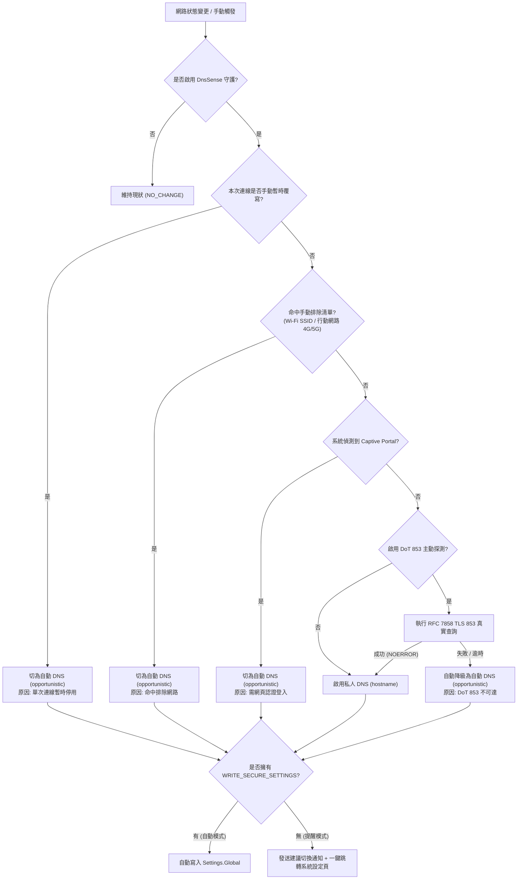

# DnsSense 系統架構規格書 (Architecture Specification)

## 1. 產品定位與核心價值

Android 內建的私人 DNS 僅提供三種靜態狀態：
- `off`：關閉加密 DNS
- `opportunistic`（自動）：僅對當前路由器配發的 DNS 嘗試升級 DoT，**不會**使用使用者指定的擋廣告 DNS
- `hostname`（指定私人 DNS）：嚴格鎖定單一 DoT 主機（例如 `dns.adguard-dns.com`），一旦網路封鎖 TCP 853 或遇到 Captive Portal 便直接斷網

**DnsSense** 補齊 Android 缺失的第四種智慧模式：**Strict-with-Fallback（帶智慧降級與排除清單的私人 DNS 守護者）**。

---

## 2. 雙層決策引擎 (Two-Layer Decision Engine)

所有網路事件都必須經過純邏輯模組 `DecisionEngine.evaluate(...)`，決策優先順序如下：

---

## 3. DoT 853 真實查詢探測協定 (`DotProber`)

僅檢查 TCP 853 能否建立連線容易遭防火牆 DPI 或透明攔截誤判。`DotProber` 實作精簡的 **RFC 7858 (DNS-over-TLS)** 探測流程：

1. 使用系統預設 `SSLSocketFactory` 連線至目標私人 DNS 主機（預設 `dns.adguard-dns.com:853`），並設定短連線與讀取逾時（預設 `2500ms`）。
2. 強制執行標準 TLS 握手與主機名稱驗證（SNI + `HostnameVerifier`）。
3. 送出 2-byte 長度前綴的標準 DNS A 記錄查詢封包（目標：`connectivitycheck.gstatic.com`）。
4. 讀取回應標頭，驗證 Transaction ID 相符、QR=1（回應封包）且 RCODE=0（`NOERROR`）。
5. 任一階段失敗即明確回報分類原因（`CONNECT_TIMEOUT` / `TLS_ERROR` / `DNS_ERROR` / `NETWORK_ERROR`），觸發自動降級。

---

## 4. 雙模式權限設計 (Auto Mode + Reminder Mode)

| 維度 | 自動模式（原生全自動） | 提醒模式（免授權降級） |
| :--- | :--- | :--- |
| 必要權限 | `WRITE_SECURE_SETTINGS`（一次性 ADB / Shizuku 授權） | 無特殊權限 |
| 重開機持久性 | 永久有效（免 Shizuku 常駐） | N/A |
| 決策後行為 | 直接寫入 `Settings.Global.private_dns_mode` | 狀態列通知提示建議目標模式，點擊直達系統網路設定頁 |
| 電池與 VPN 影響 | 極低耗電、不佔用 VPN 槽位 | 極低耗電、不佔用 VPN 槽位 |

---

## 5. 防衛性設計細節

- **防抖動（Debounce）**：Wi-Fi 與行動數據切換瞬間會連續觸發多次 `NetworkCallback`，引擎採用 `1500ms` 防抖視窗，避免短時間內反覆震盪寫入系統設定。
- **單次覆寫自動歸零**：使用者透過下拉快速磚（Quick Settings Tile）點擊「本次暫時切回自動 DNS」時，只綁定當前網路特徵（Network Key）；一旦離開該網路，覆寫自動失效並恢復私人 DNS 守護。
- **跨版本設定相容**：設定儲存於 `SharedPreferences`，所有列表與設定物件均透過 `JsonParser` 逐欄安全解析，杜絕欄位擴充造成的空指標異常。
